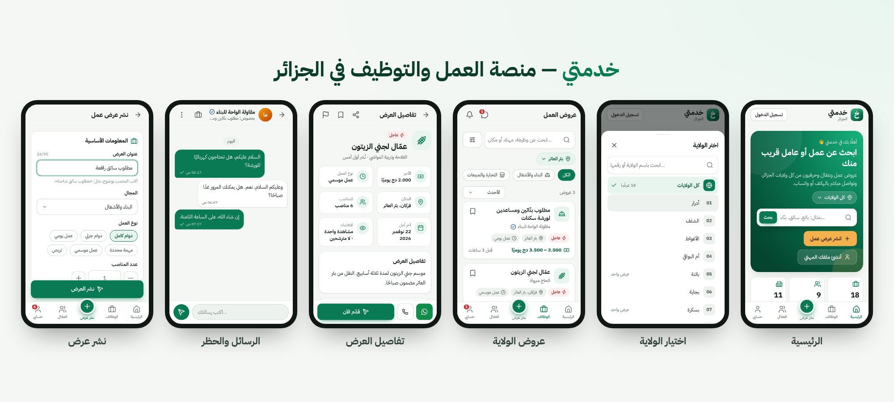
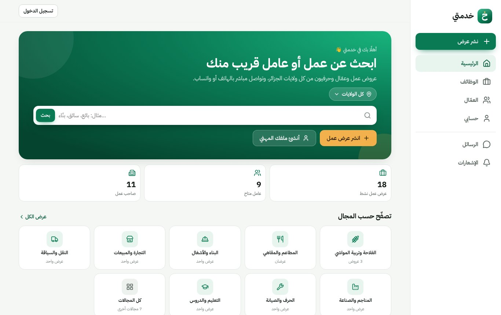
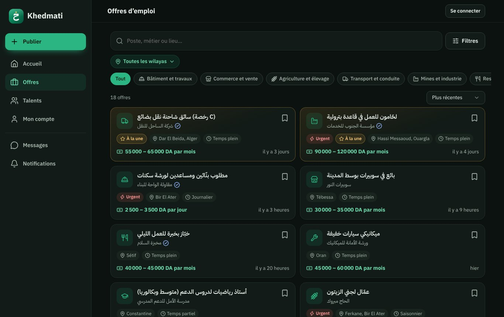

# خدمتي — منصة العمل والتوظيف في الجزائر

**خدمتي** تطبيق ويب تقدّمي (PWA) يجمع أصحاب العمل والباحثين عن عمل في **كل ولايات الجزائر وبلدياتها**:
69 ولاية و1541 بلدية حسب التقسيم الإداري لسنة 2026. يُثبَّت على الهاتف كتطبيق، وجاهز للنشر على **Google Play**،
ويعمل بالعربية والفرنسية حتى مع إنترنت ضعيف. صُنع في بئر العاتر.

## ابدأ من هنا

**[docs/google-play.md](docs/google-play.md)**: ثلاث مراحل من المتصفح، بدون برمجة، كل خطوة باسم الزر:

1. ضع الموقع على الإنترنت بزر واحد (Render، قرص دائم ونسخ احتياطي يومي، لا شيء تكتبه).
2. كن أنت المالك: أول حساب يُنشأ في الموقع يصبح حساب المالك (لوحة الإدارة وكل الصلاحيات).
3. انشره على Google Play (نصوص المتجر وصوره وإجابات الاستمارات جاهزة في [store/](store/)).

[](https://render.com/deploy?repo=https://github.com/houssemallouane10-ai/Nadouch/tree/claude/idea-suggestion-app-1dgg56)



| الحاسوب — العربية | الحاسوب — الفرنسية، الوضع الداكن |
| --- | --- |
|  |  |

> اللقطات مأخوذة من النسخة التجريبية ببيانات وهمية (`npm run seed:demo`).

---

## المميزات

**في كل الجزائر**
- اختيار الولاية من قائمة الـ 69 ولاية (بحث بالاسم أو الرقم، مع عدد العروض في كل ولاية)، ثم البلدية.
- الولاية المختارة تُحفظ على الجهاز: الرئيسية والعروض والعمّال تعرض ولايتك أولًا، مع «كل الولايات» بلمسة.
- كل عرض مرتبط ببلدية، وكل ملف بولاية (والبلدية اختيارية). البحث يفهم أسماء الأماكن بالعربية والفرنسية.

**للباحثين عن عمل**
- تصفّح عروض العمل مع بحث ذكي يتسامح مع الإملاء (أ/ا، ة/ه، ى/ي، بدون تشكيل) وفلاتر: الولاية، البلدية، المجال، نوع العمل، تاريخ النشر، العروض العاجلة، الأجر المحدد.
- التقديم على العرض برسالة قصيرة ومتابعة حالة الطلب (قيد المراجعة، القائمة القصيرة، مقبول، غير مقبول) وسحب الطلب.
- ملف مهني (المهنة، المهارات، الخبرة، الأجر المطلوب) مع خيار الظهور في **دليل العمّال والحرفيين**.
- تنبيهات بالعروض الجديدة في المجالات المختارة، في ولاية واحدة أو في كل الجزائر.

**لأصحاب العمل**
- نشر عرض في دقيقتين مع حفظ تلقائي للمسودة، ومدة نشر (7 / 15 / 30 / 60 يومًا)، وعلامة «عاجل».
- لوحة «عروضي»: المشاهدات، عدد المترشحين والجدد منهم، إغلاق / إعادة فتح / تجديد / حذف.
- إدارة المترشحين: الاتصال، واتساب برسالة جاهزة، المراسلة، والقبول أو الرفض مع إشعار تلقائي للمترشح.

**للجميع**
- رسائل داخلية مع إشعارات القراءة، وإشعارات داخل التطبيق، وشارات العدد على الأيقونات.
- المحفوظات (عروض وعمّال)، المشاركة على واتساب وفيسبوك مع معاينة الرابط، والإبلاغ عن العروض والحسابات والمحادثات.
- **حظر** أي شخص من المحادثة أو من ملفه: لا يستطيع مراسلتك وتختفي محادثته، مع قائمة المحظورين في الإعدادات.
- العربية (من اليمين لليسار) والفرنسية، الوضع الفاتح والداكن، وتصميم للهاتف والحاسوب.
- تطبيق قابل للتثبيت يعمل دون اتصال بآخر البيانات المحمّلة، ويعرض التحديثات الجديدة بلمسة.

**الإدارة**
- **المالك** هو أول حساب يُنشأ في المنصة (شاشة «إعداد منصتك»): يملك كل الصلاحيات، وهو وحده من يعيّن المشرفين أو يزيلهم.
- **إعدادات المنصة** للمالك من لوحة الإدارة: رقم واتساب وبريد الدعم، وربط تطبيق أندرويد (بصمات SHA-256)، بدون لمس إعدادات الخادم.
- لوحة مؤشرات مع **النشاط حسب الولاية**، معالجة البلاغات، حجب العروض وتمييزها، حظر الحسابات وتوثيقها، تصفية القوائم حسب الولاية، وكلمة سر مؤقتة لمن نسي كلمة سره.

**الأمان والخصوصية**
- كلمات سر مشفّرة (scrypt)، جلسات في كعكات HttpOnly، حماية من الطلبات القادمة من مواقع أخرى، وسياسة أمان المحتوى (CSP).
- حدود للطلبات (تسجيل الدخول، النشر، الرسائل) ضد الإزعاج، وتحقق من كل المدخلات في الخادم.
- رقم الباحث عن عمل لا يظهر إلا لمن تقدّم إليه أو إذا اختار الظهور في الدليل، وحذف الحساب نهائي بكل بياناته.
- قبول شروط الاستخدام إلزامي عند التسجيل، وصفحات الخصوصية والشروط وحذف الحساب تُعرض حتى بدون JavaScript (كما يطلب Google Play).

---

## التشغيل على جهازك

المتطلبات: **Node.js 20.11 أو أحدث**.

```bash
npm install
npm run seed:demo   # اختياري: بيانات تجريبية لتجربة التطبيق
npm start           # http://localhost:3000
```

حسابات النسخة التجريبية (كلمة السر لكل الحسابات: `demo12345`):

| الحساب | الهاتف |
| --- | --- |
| صاحب عمل (بئر العاتر) | `0555000001` |
| عامل، كهربائي (بئر العاتر) | `0555000011` |
| مالك المنصة (لوحة الإدارة) | `0555000000` |

البيانات التجريبية موزعة على 13 ولاية (الجزائر، وهران، قسنطينة، سطيف، تبسة، بئر العاتر، ورقلة…).

لإعادة التجربة من الصفر احذف المجلد `data/`.

## النشر على الإنترنت

التطبيق خادم Node.js واحد يحفظ بياناته في ملف SQLite داخل `DATA_DIR`.
**المهم:** يجب أن يكون هذا المجلد على قرص دائم، وإلا ضاعت البيانات عند إعادة تشغيل الخادم.

### الطريقة الموصى بها: Render بزر واحد

الملف [`render.yaml`](render.yaml) يجهّز كل شيء: خادم Node 22 في فرانكفورت، قرص دائم 1 GB على `/data` وفحص الصحة،
دون أي قيمة تكتبها. الخطوات بالتفصيل في [docs/google-play.md](docs/google-play.md#1-ضع-الموقع-على-الإنترنت).

### خيار آخر: خادم VPS أو أي منصة تدعم Docker

```bash
docker build -t khedmati .
docker run -d --name khedmati --restart unless-stopped \
  -p 127.0.0.1:3000:3000 \
  -v khedmati-data:/data \
  -e TRUST_PROXY=1 \
  -e PUBLIC_URL=https://khedmati.example \
  khedmati
```

ثم ضع أمامه Caddy (يستخرج شهادة HTTPS تلقائيًا) أو Nginx، مثلًا بملف Caddyfile من سطر واحد:
`khedmati.example { reverse_proxy 127.0.0.1:3000 }`

### خيار آخر: Railway أو Fly.io

- أمر البناء: `npm ci --omit=dev` — أمر التشغيل: `npm start`
- أضف **قرصًا دائمًا (Volume / Disk)** واجعل `DATA_DIR` يشير إليه (مثل `/data`).
- اضبط `TRUST_PROXY=1` و`NODE_ENV=production` و`PUBLIC_URL`.

### متغيرات البيئة

| المتغير | الوصف | القيمة الافتراضية |
| --- | --- | --- |
| `PORT` | منفذ الخادم | `3000` |
| `NODE_ENV` | `production` في النشر | `development` |
| `DATA_DIR` | مجلد قاعدة البيانات (قرص دائم) | `./data` |
| `PUBLIC_URL` | رابط الموقع، لروابط المشاركة وخريطة الموقع | `RENDER_EXTERNAL_URL` على Render، وإلا من الطلب |
| `TRUST_PROXY` | `1` خلف بروكسي HTTPS (Render، Railway، Nginx…) | معطّل |
| `SUPPORT_WHATSAPP` | قيمة أولية لرقم واتساب الدعم (المالك يغيّره من لوحة الإدارة ← الإعدادات) | — |
| `SUPPORT_EMAIL` | قيمة أولية لبريد الدعم (المالك يغيّره من لوحة الإدارة ← الإعدادات) | — |
| `ANDROID_PACKAGE_NAME` | قيمة أولية لاسم حزمة أندرويد | `dz.khedmati.app` |
| `ANDROID_SHA256_FINGERPRINTS` | قيمة أولية لبصمات SHA-256 (المالك يضيفها من لوحة الإدارة ← الإعدادات) | — |
| `SESSION_DAYS` | مدة الجلسة بالأيام | `60` |
| `BACKUP_DAYS` | عدد النسخ الاحتياطية اليومية المحفوظة في `DATA_DIR/backups` (`0` يعطّلها) | `7` |
| `RATE_LIMITS` | `off` لتعطيل حدود الطلبات (للاختبارات فقط) | مفعّل |

انسخ `.env.example` كمرجع لهذه القيم.

### المالك والمشرفون

منصة جديدة (بدون أي حساب) تعرض لأول زائر شاشة **«إعداد منصتك»**: الحساب الذي يُنشأ فيها هو **المالك**، فافتح موقعك
وسجّل مباشرة بعد النشر. بعدها كل من يسجّل مستخدم عادي. المالك يعيّن المشرفين أو يزيلهم من «المستخدمون»، ولا يُحذف
حسابه ما دام المالك الوحيد. ومن سطر أوامر الخادم (Shell على Render):

```bash
npm run reset-password -- 06XXXXXXXX     # كلمة سر مؤقتة إن نسيت كلمة سرك
npm run make-owner -- 06XXXXXXXX         # جعل حساب مالكًا (أو --revoke لإزالته)
npm run make-admin -- 06XXXXXXXX         # جعل حساب مشرفًا
```


### نسخ احتياطي

الخادم ينسخ قاعدة البيانات **تلقائيًا كل يوم** إلى `DATA_DIR/backups/khedmati-YYYY-MM-DD.db` ويحتفظ بآخر 7 نسخ.
للرجوع إلى نسخة: أوقف الخادم، انسخ الملف المطلوب مكان `DATA_DIR/khedmati.db`، احذف `khedmati.db-wal` و`khedmati.db-shm`، ثم شغّله.
ولنسخة خارج الخادم، حمّل أحد هذه الملفات من حين لآخر.

---

## الاختبارات

```bash
npm test
```

60 اختبارًا تغطي: الحسابات والجلسات، العروض ودورة حياتها، الولايات والبلديات، التقديم والقرارات، الرسائل والحظر، الإشعارات والتنبيهات حسب الولاية، الإدارة والمالك الأول والمشرفين وإعدادات المنصة، الأمان، صفحات Google Play (assetlinks والصفحات القانونية)، ترقية قاعدة البيانات من النسخة الأولى، النسخ الاحتياطي وإعدادات التشغيل، والواجهة (روابط المشاركة وخريطة الموقع وملف Service Worker).

## بنية المشروع

```
server/                خادم Express (طبقة HTTP رفيعة فوق خدمات المجالات)
  domains/             كل مجال في مجلده: accounts, jobs, applications, bookmarks,
                       notifications, messaging, moderation, platform (إعدادات المالك)
  api/router.js        تجميع واجهة /api مع الحدود والحماية
  web/                 صفحة التطبيق، معاينات المشاركة، خريطة الموقع، Service Worker
  shared/              قاعدة البيانات والترحيلات والنسخ الاحتياطي، التحقق، البحث، أدوات HTTP
shared/                بيانات مشتركة بين الخادم والمتصفح (المجالات، الولايات والبلديات، الحدود، الهاتف)
public/                التطبيق (JavaScript بدون أدوات بناء)
  js/app/              الموجّه، الحالة، الواجهة العامة، PWA
  js/features/         شاشات التطبيق مقسّمة حسب الميزة
  js/shared/           القوالب الآمنة، الترجمة، التنسيق، المكوّنات، النماذج
  js/locales/          العربية والفرنسية
  css/app.css          نظام التصميم (RTL/LTR، فاتح/داكن)
scripts/               بيانات تجريبية، ترقية مالك أو مشرف، كلمة سر مؤقتة، توليد الولايات والبلديات
store/                 نصوص Google Play وصوره وإجابات «أمان البيانات»
test/                  اختبارات الواجهة البرمجية (node:test)
docs/architecture.md   ملاحظات معمارية
docs/google-play.md    دليل النشر: الاستضافة، المالك، Google Play
render.yaml            الاستضافة على Render بزر واحد
```

## الخطوات القادمة المقترحة

- التحقق من رقم الهاتف برسالة SMS (يتطلب مزوّد رسائل مدفوع).
- إشعارات Push على الهاتف حتى والتطبيق مغلق.
- تقييمات للعمّال بعد إتمام العمل.

## حقوق الأصول

- خط IBM Plex Sans Arabic — رخصة SIL Open Font License 1.1 (`public/fonts/OFL.txt`).
- أيقونات [Lucide](https://lucide.dev) — رخصة ISC، وشعار واتساب من [Simple Icons](https://simpleicons.org) — CC0.
- الولايات والبلديات: [me-yasserzaouag/algeria-wilayas-communes](https://github.com/me-yasserzaouag/algeria-wilayas-communes) و[islam-re/Algeria-wilayas](https://github.com/islam-re/Algeria-wilayas) — رخصة MIT، مع تصحيحات يدوية في `scripts/build-geo.js`.
